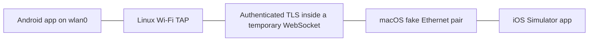

# Hosted Android–iOS LAN testing

The workflow pairs `ubuntu-24.04` with `macos-26`. Android runs a KVM-accelerated x86-64 Google APIs emulator. The Mac preflight asserts `uname -m = arm64` and boots an iPhone Simulator. Both apps run concurrently. One external agent can authenticate to both UI sessions and coordinate actions.

Android attaches its Wi-Fi adapter to a dedicated Linux TAP and keeps the emulator's control channel. The Mac creates an isolated fake Ethernet pair for Simulator networking. The runners forward original IPv4 Ethernet frames between the two interfaces. The filter limits the LAN to the two test addresses, ARP, IPv4 mDNS, TCP, and ICMP. It leaves DHCP on the Android runner. Native DNS-SD discovery and P2pKit connections use the same network path when the apps run.

The two jobs exchange public, ephemeral TLS certificates through artifacts scoped to one run and attempt. Each bridge endpoint requires the other certificate. Cloudflare Quick Tunnel transports the WebSocket, and the two runners terminate the inner mutual TLS connection. Private keys stay in the job's temporary directory. The existing UI action separately authenticates access to each screen with its own bearer. Cleanup stops the relay and devices, destroys the virtual interfaces, and deletes the LAN private keys.

## Verification status

| Check | Observation |
| --- | --- |
| Concurrent hosted runtimes and IPv4 transport | Android and the Mac each received all three ICMP replies over the authenticated bridge. [Run](https://github.com/ui-test-actions/ui-test-actions/actions/runs/44729372549) · [Ping evidence](../verification/mobile-lan/evidence/transport/) |
| P2pKit mDNS wire delivery | Nine Android service queries and five service responses were counted on both sides of the bridge. [Run](https://github.com/ui-test-actions/ui-test-actions/actions/runs/44730692599) · [Counters](../verification/mobile-lan/evidence/unsigned-ios/) |
| Native discovery | The upstream P2pKit apps each rendered the other app's advertised name. Android initially showed zero peers. Both apps used their discovered peer rows. [Paired run](https://github.com/ui-test-actions/ui-test-actions/actions/runs/44736388856) · [Android discovery](../verification/mobile-lan/evidence/p2pkit-44736388856/android-discovered.png) · [iOS discovery](../verification/mobile-lan/evidence/p2pkit-44736388856/ios-discovered.png) |
| Authenticated pairing | Both UIs showed Connected after selection from the iOS peer list. After restarting Android, Android initiated a new connection and iOS showed the incoming session. Both native app diagnostics logged two authentication successes. [Android events](../verification/mobile-lan/evidence/p2pkit-44736388856/android-app-events.json) · [iOS events](../verification/mobile-lan/evidence/p2pkit-44736388856/ios-app-events.json) |
| Bidirectional app messages | In the Android-initiated session, iOS rendered `Android hello MANGO` and Android rendered `iOS reply MANGO` from iPhone. [iOS receiver](../verification/mobile-lan/evidence/p2pkit-44736388856/ios-received-android.png) · [Android receiver](../verification/mobile-lan/evidence/p2pkit-44736388856/android-received-ios-reply.png) |
| File offer, consent, and completion | iOS offered a 200 KiB file. Android showed the incoming offer and accepted it. Both UIs reported completion. Android showed the SHA-256 and saved destination. [Offer](../verification/mobile-lan/evidence/p2pkit-44736388856/android-file-offer.png) · [Android receiver](../verification/mobile-lan/evidence/p2pkit-44736388856/android-file-completed.png) · [iOS sender](../verification/mobile-lan/evidence/p2pkit-44736388856/ios-file-completed.png) |
| Expiry and cleanup | Both jobs passed their LAN cleanup step. External authenticated requests still worked with 6 seconds left for Android and 4 seconds left for iOS. Both endpoints returned HTTP 530 on two requests after expiry. [Closure checks](../verification/mobile-lan/evidence/p2pkit-44736388856/closure.json) · [Job steps](../verification/mobile-lan/evidence/p2pkit-44736388856/run.json) |

The first successful app session ran the published action at `c06857b0a96d989f0b196206792f1cbae8723d58` and the paired workflow at `c7d0002a0614da7166f2abef708dc173362aa535`. Its wire counters record Android sending 18 service queries and 18 responses, and iOS sending 12 service queries and 6 responses. The opposing interfaces recorded receipt of all those service packets. [Android wire counters](../verification/mobile-lan/evidence/p2pkit-44736388856/android-traffic.json) · [iOS wire counters](../verification/mobile-lan/evidence/p2pkit-44736388856/ios-traffic.json) · [Apple Silicon proof](../verification/mobile-lan/evidence/p2pkit-44736388856/ios-architecture.txt)

## Reproduce

1. Dispatch **Build pinned P2pKit mobile LAN sample apps**. The workflow builds the Apache-2.0 P2pKit samples at `fd3cd74fcc82d342ee6c5a305f7ed15b0b7ed19d`. Keep the artifact run IDs for each platform. The paired workflow checks the revision marker and the package digest before deployment.
2. Dispatch **Verify hosted mobile LAN transport** in `transport` mode for the IP check. In `apps` mode, supply the two sample artifact run IDs and generate a different bearer and SHA-256 digest for each UI session using the [main connection guide](../README.md#connect-and-hand-the-session-to-an-agent). Pass each digest as its respective workflow input.
3. Download both `ui-session-...` artifacts while the jobs are running. Use the `target` in each `connection.json` to associate it with the correct private token file. Keep the bearer files local to the agent.
4. Use [inspect-pair.py](../verification/mobile-lan/inspect-pair.py) to capture both sessions and inspect the available UI. Start both apps, select the discovered peer from the visible peer list, and verify that each receiver displays a distinct message. To test file consent, choose **Send test file** and **200 KiB** in the iOS session. On Android, scroll to the incoming offer and select **Accept**. Check the completion state on both screens.

The jobs give each UI session 15 minutes after its app launches. Begin test actions after both connection artifacts appear. The shared test window ends at the earlier expiry. Each job then stops its relay or bridge process, shuts down its mobile runtime, removes its isolated interfaces, and deletes its job-local LAN key. The job artifacts include packet counters and allowlisted sample event names and state values.

For other applications, retain the two hosted jobs, LAN preparation and bridge steps, and cleanup from the [paired workflow](../.github/workflows/mobile-lan-transport.yml). Replace the sample build and preparation with your consumer builds. Pass the selected device and app ID or bundle ID to the [live UI action](../action.yml), with your install and launch command. Keep both apps on the isolated LAN and use their normal discovery and pairing controls. Run the paired proof before relying on a different emulator or Simulator image.

The visible Simulator driver uses desktop coordinates. Dismiss the runner's Python local-network prompt if it appears and focus the Simulator window. The optional AXe driver has native tree support. Its first P2pKit run failed at `describe-ui` after capturing a valid Simulator image. Both app builds are reused across retries. The original unsigned app launched but reported `PERMISSION_OR_ENTITLEMENT_DENIED` when creating its secure identity. Adding restricted Keychain entitlements to a post-build signature caused SpringBoard to deny launch. The current build passes the sample-only Keychain configuration through Xcode’s Simulator packaging and checks for the linked simulated entitlement section. The sample still uses its native Keychain and upstream authenticated-v2 configuration. [Apple Keychain access groups](https://developer.apple.com/documentation/Security/sharing-access-to-keychain-items-among-a-collection-of-apps)

## Scope

This is an isolated IPv4 LAN on hosted VMs. Physical Wi-Fi and Bluetooth radios, AWDL, Wi-Fi Direct, IPv6, VPN coexistence, and router-less link-local qualification need their own tests. The upstream samples authenticate peer key possession within their shared sample AppId. Production policy such as fingerprint pinning and interoperability with an independent secure-v2 implementation need separate acceptance. Quick Tunnel availability can affect the relay and the UI endpoints. An interrupted LAN relay can require another workflow run.

The hosted results cover the Android and iOS LAN and role portions of the P2pKit validation catalog, including file consent. The device matrix, AP-specific routing conditions, and fault-injection cases remain open. [P2pKit test catalog at the tested source pin](https://github.com/p2pKit/P2pKit/blob/fd3cd74fcc82d342ee6c5a305f7ed15b0b7ed19d/docs/validation/test-catalog.md)

[Sample build workflow](../.github/workflows/mobile-lan-apps.yml) · [Paired runner workflow](../.github/workflows/mobile-lan-transport.yml) · [Portable bridge tests](../verification/mobile-lan/test_bridge.py)
