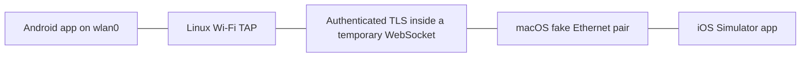

# Hosted Android–iOS LAN testing

The workflow pairs `ubuntu-24.04` with `macos-26`. Android runs a KVM-accelerated x86-64 Google APIs emulator. The Mac preflight asserts `uname -m = arm64` and boots an iPhone Simulator. Both apps run concurrently. One external agent can authenticate to both UI sessions and coordinate actions.



Android attaches its Wi-Fi adapter to a dedicated Linux TAP and keeps the emulator's control channel. The Mac creates an isolated fake Ethernet pair for Simulator networking. The runners forward original IPv4 Ethernet frames between the two interfaces. The filter limits the LAN to the two test addresses, ARP, IPv4 mDNS, TCP, and ICMP. It leaves DHCP on the Android runner. Native DNS-SD discovery and P2pKit connections use the same network path when the apps run.

The separate runners give Android hardware acceleration and iOS an ARM64 Mac. Android's built-in shared Wi-Fi feature connects Android emulators. The dedicated TAP gives this Android guest a path to the Mac. A routed link would still need a way to preserve link-local discovery across both runtimes. Forwarding the original mDNS frames lets both apps use their normal browse and advertise APIs. Both apps obtain their peer addresses from native DNS-SD. [GitHub runner hardware](https://docs.github.com/en/actions/reference/runners/github-hosted-runners) · [Android emulator networking](https://developer.android.com/studio/run/emulator-networking-interconnect) · [Multicast DNS](https://www.rfc-editor.org/rfc/rfc6762.html)

The two jobs exchange public, ephemeral TLS certificates through artifacts scoped to one run and attempt. Each bridge endpoint requires the other certificate. Cloudflare Quick Tunnel transports the WebSocket, and the two runners terminate the inner mutual TLS connection. Private keys stay in the job's temporary directory. The existing UI action separately authenticates access to each screen with its own bearer. Cleanup stops the relay and devices, destroys the virtual interfaces, and deletes the LAN private keys.

## Verification status

| Check | Observation |
| --- | --- |
| Concurrent hosted runtimes and IPv4 transport | Android and the Mac each received all three ICMP replies over the authenticated bridge. [Run](https://github.com/ui-test-actions/ui-test-actions/actions/runs/44729372549) · [Ping evidence](../verification/mobile-lan/evidence/transport/) |
| P2pKit mDNS wire delivery | Nine Android service queries and five service responses were counted on both sides of the bridge. [Run](https://github.com/ui-test-actions/ui-test-actions/actions/runs/44730692599) · [Counters](../verification/mobile-lan/evidence/unsigned-ios/) |
| Native discovery | The upstream P2pKit apps each rendered the other app's advertised name. Android initially showed zero peers. Both apps used their discovered peer rows. [Paired run](https://github.com/ui-test-actions/ui-test-actions/actions/runs/44736388856) · [Android discovery](../verification/mobile-lan/evidence/p2pkit-44736388856/android-discovered.png) · [iOS discovery](../verification/mobile-lan/evidence/p2pkit-44736388856/ios-discovered.png) |
| Authenticated pairing | Both UIs showed Connected after selection from the iOS peer list. After restarting Android, Android initiated a new connection and iOS showed the incoming session. Both native app diagnostics logged two authentication successes. [Android events](../verification/mobile-lan/evidence/p2pkit-44736388856/android-app-events.json) · [iOS events](../verification/mobile-lan/evidence/p2pkit-44736388856/ios-app-events.json) |
| Bidirectional app messages | In the Android-initiated session, iOS rendered `Android hello MANGO` and Android rendered `iOS reply MANGO` from iPhone. [iOS receiver](../verification/mobile-lan/evidence/p2pkit-44736388856/ios-received-android.png) · [Android receiver](../verification/mobile-lan/evidence/p2pkit-44736388856/android-received-ios-reply.png) |
| File offer, consent, and completion | iOS offered a 200 KiB file. Android showed the incoming offer and accepted it. Both UIs reported completion. The SHA-256 shown on Android matched the digest computed from the pinned iOS fixture generator. [Offer](../verification/mobile-lan/evidence/p2pkit-44736388856/android-file-offer.png) · [Android receiver](../verification/mobile-lan/evidence/p2pkit-44736388856/android-file-completed.png) · [iOS sender](../verification/mobile-lan/evidence/p2pkit-44736388856/ios-file-completed.png) · [Digest comparison](../verification/mobile-lan/evidence/p2pkit-44736388856/android-transfer.json) |
| Expiry and cleanup | Both jobs passed their LAN cleanup step. External authenticated requests still worked with 6 seconds left for Android and 4 seconds left for iOS. Both endpoints returned HTTP 530 on two requests after expiry. [Closure checks](../verification/mobile-lan/evidence/p2pkit-44736388856/closure.json) · [Job steps](../verification/mobile-lan/evidence/p2pkit-44736388856/run.json) |

The first successful app session ran the published action at `c06857b0a96d989f0b196206792f1cbae8723d58` and the paired workflow at `c7d0002a0614da7166f2abef708dc173362aa535`. Its wire counters record Android sending 18 service queries and 18 responses, and iOS sending 12 service queries and 6 responses. The opposing interfaces recorded receipt of all those service packets. [Android wire counters](../verification/mobile-lan/evidence/p2pkit-44736388856/android-traffic.json) · [iOS wire counters](../verification/mobile-lan/evidence/p2pkit-44736388856/ios-traffic.json) · [Apple Silicon proof](../verification/mobile-lan/evidence/p2pkit-44736388856/ios-architecture.txt)

A fresh pair at the same action and workflow pins repeated bidirectional messaging after **iOS** initiated pairing. Android rejected a second 200 KiB file offer and iOS displayed **Rejected by user** with zero bytes sent. After closing the connection, switching off Android advertising removed the peer from the iOS Bonjour list. Turning advertising back on made the peer reappear. [Repeat run](https://github.com/ui-test-actions/ui-test-actions/actions/runs/44737698097) · [Receiver observations](../verification/mobile-lan/evidence/p2pkit-44737698097/journey.json) · [File rejection](../verification/mobile-lan/evidence/p2pkit-44737698097/ios-file-rejected.png) · [Peer withdrawn](../verification/mobile-lan/evidence/p2pkit-44737698097/ios-peer-withdrawn.png) · [Peer restored](../verification/mobile-lan/evidence/p2pkit-44737698097/ios-peer-restored.png)

A separate live run verified authentication and cancellation. Each UI endpoint returned 401 for the other session's bearer. The relay closed an attempted WebSocket client that lacked an authenticated inner TLS connection. After the GitHub cancellation request, the first externally observed closure was 18.0 seconds for Android and 32.2 seconds for iOS. Both cleanup steps succeeded and the relay then rejected WebSocket upgrades. [Cancellation run](https://github.com/ui-test-actions/ui-test-actions/actions/runs/44739384567) · [Authentication and timing evidence](../verification/mobile-lan/evidence/p2pkit-44739384567/)

The coordinated chat verifier completed with exit code 0 in a further run at workflow pin `5794ff0042c8895da952e9b169d2935a3d8f6f18`, using the same action pin. It started both kits, verified both peer names, connected from iOS, and read an incoming line on each receiver. The iOS capture shows `Android-7224 -> MANGO`. The Android tree and screenshot show `iPhone → iOS reply MANGO`. The evidence includes the exact verifier source checksum. [Automated run](https://github.com/ui-test-actions/ui-test-actions/actions/runs/44741710196) · [Verifier evidence](../verification/mobile-lan/evidence/p2pkit-44741710196/)

## Reproduce

1. Dispatch **Build pinned P2pKit mobile LAN sample apps**. The workflow builds the Apache-2.0 P2pKit samples at `fd3cd74fcc82d342ee6c5a305f7ed15b0b7ed19d`. Keep the artifact run IDs for each platform. The paired workflow checks the revision marker and the package digest before deployment. Rebuild the pinned sample if its artifact has expired. [Android build job](https://github.com/ui-test-actions/ui-test-actions/actions/runs/44727058613) · [Simulator build](https://github.com/ui-test-actions/ui-test-actions/actions/runs/44733760941)
2. Dispatch **Verify hosted mobile LAN transport** in `transport` mode for the IP check. In `apps` mode, supply the two sample artifact run IDs and generate a different bearer and SHA-256 digest for each UI session using the [main connection guide](../README.md#connect-and-hand-the-session-to-an-agent). Pass each digest as its respective workflow input.
3. Download both `ui-session-...` artifacts while the jobs are running. Use the `target` in each `connection.json` to associate it with the correct private token file. Keep the bearer files local to the agent.
4. Use [inspect-pair.py](../verification/mobile-lan/inspect-pair.py) to capture both sessions and inspect the available UI. Start both apps, select the discovered peer from the visible peer list, and verify that each receiver displays a distinct message. To test file consent, choose **Send test file** and **200 KiB** in the iOS session. On Android, scroll to the incoming offer and select **Accept**. Check the completion state on both screens.

The jobs give each UI session 15 minutes after its app launches. Begin test actions after both connection artifacts appear. The shared test window ends at the earlier expiry. Each job then stops its relay or bridge process, shuts down its mobile runtime, removes its isolated interfaces, and deletes its job-local LAN key. The job artifacts include packet counters and allowlisted sample event names and state values.

For other applications, retain the two hosted jobs, LAN preparation and bridge steps, and cleanup from the [paired workflow](../.github/workflows/mobile-lan-transport.yml). Replace the sample build and preparation with your consumer builds. Pass the selected device and app ID or bundle ID to the [live UI action](../action.yml), with your install and launch command. Keep both apps on the isolated LAN and use their normal discovery and pairing controls. Run the paired proof before relying on a different emulator or Simulator image.

The paired workflow's **network** mode enables [scoped delay, rate, loss, and outage profiles](environment.md) and keeps the two app control sessions reachable while the private link is impaired.

The visible Simulator driver uses desktop coordinates. Dismiss the runner's Python local-network prompt if it appears and focus the Simulator window. The optional AXe driver has native tree support. Its first P2pKit run failed at `describe-ui` after capturing a valid Simulator image. Both app builds are reused across retries. The original unsigned app launched but reported `PERMISSION_OR_ENTITLEMENT_DENIED` when creating its secure identity. Adding restricted Keychain entitlements to a post-build signature caused SpringBoard to deny launch. The current build passes the sample-only Keychain configuration through Xcode’s Simulator packaging and checks for the linked simulated entitlement section. The sample still uses its native Keychain and upstream authenticated-v2 configuration. [Apple Keychain access groups](https://developer.apple.com/documentation/Security/sharing-access-to-keychain-items-among-a-collection-of-apps)

In an isolated follow-up with the same P2pKit build, the workflow waited for the frontmost app's AXe tree and a valid Simulator framebuffer. The external client then obtained 29 visible SwiftUI nodes, targeted the display-name field, and read the exact replacement `LAN AXe observed` from a fresh tree. The multi-device LAN evidence used the visible driver. [AXe run 44765711184](https://github.com/ui-test-actions/ui-test-actions/actions/runs/44765711184) · [Native evidence](../verification/v2/ios-axe/p2pkit-ready/) · [AXe compatibility](https://github.com/cameroncooke/AXe)

### Run the coordinated chat check

Leave the native apps on their initial screens. Use the screenshot and Android tree to read the Android device name and check the location of the Simulator and its Start button. On the tested 1024 × 768 macOS desktop the Simulator content occupied `381 130 643 699` and Start was at `408 320`. Update the coordinates if the window moves. Dismiss the Python permission alert if it covers the app.

The verifier uses the existing HTTPS agent client for both devices. Its visible Simulator mode uses Tesseract and Pillow on the machine running the verifier. Manual interaction needs only the agent client and the two connection files. Keep all token and connection files private.

```bash
python3 verification/mobile-lan/p2pkit-journey.py \
  --android-connection android.connection.json --android-token android.token \
  --ios-connection ios.connection.json --ios-token ios.token \
  --android-name Android-6488 --ios-name iPhone --nonce ORANGE --initiator ios \
  --ios-ocr "$(command -v tesseract)" --ios-crop 381 130 643 699 --ios-start 408 320 \
  --output ./pair-evidence
```

Replace the example Android name and use a fresh short word for each run. Set `--initiator android` to exercise Android dialing. The check requires both apps to render the other peer, both to show a connected state, and each receiver to show a message attributed to the other device. Android sends the word and iOS replies with `iOS reply` followed by that word. The visible iOS check requires the exact payload and binds the sender to the numeric suffix already observed during discovery. This accommodates OCR spelling errors in the small Android label. It writes screenshots and `journey.json`.

## Scope

This is an isolated IPv4 LAN on hosted VMs. Its reserved test addresses are `192.168.137.10` for the Android guest and `192.168.137.2` for the Simulator side. Application payloads in the verified path use TCP. Physical Wi-Fi and Bluetooth radios, AWDL, Wi-Fi Direct, IPv6, VPN coexistence, and router-less link-local qualification need their own tests. The upstream samples authenticate peer key possession within their shared sample AppId. Production policy such as fingerprint pinning and interoperability with an independent secure-v2 implementation need separate acceptance. Quick Tunnel availability can affect the relay and the UI endpoints. An interrupted LAN relay can require another workflow run.

The hosted results cover the Android and iOS LAN and role portions of the P2pKit validation catalog, including file consent. The device matrix, AP-specific routing conditions, and fault-injection cases remain open. [P2pKit test catalog at the tested source pin](https://github.com/p2pKit/P2pKit/blob/fd3cd74fcc82d342ee6c5a305f7ed15b0b7ed19d/docs/validation/test-catalog.md) · [Secure-v2 roles](https://github.com/p2pKit/P2pKit/issues/551#issuecomment-7040426112) · [Android LAN](https://github.com/p2pKit/P2pKit/issues/546#issuecomment-7040426862) · [iOS LAN](https://github.com/p2pKit/P2pKit/issues/547#issuecomment-7040427514)

During the cancellation trial, the Android sample showed **Retry cleanup** after both kits were stopped. The retry stayed on that screen. Force-stopping the Android sample and opening the **P2pKit Sample** launcher entry restored the session and allowed a fresh authenticated exchange. The workflow starts the known sample activity explicitly. The package-only Android `app.launch` command returned a driver error when tried against this sample, which also has a separate RPC launcher entry. [Cancellation trial](https://github.com/ui-test-actions/ui-test-actions/actions/runs/44739384567)

[Sample build workflow](../.github/workflows/mobile-lan-apps.yml) · [Paired runner workflow](../.github/workflows/mobile-lan-transport.yml) · [Portable bridge tests](../verification/mobile-lan/test_bridge.py)
