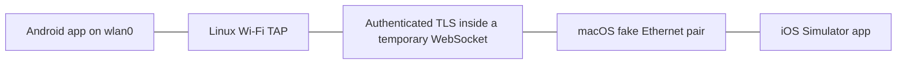

# Hosted Android–iOS LAN testing

The experiment pairs `ubuntu-24.04` with `macos-26`. Android runs a KVM-accelerated x86-64 Google APIs emulator. The Mac preflight asserts `uname -m = arm64` and boots an iPhone Simulator.

Android attaches its Wi-Fi adapter to a dedicated Linux TAP and keeps the emulator's control channel. The Mac creates an isolated fake Ethernet pair for Simulator networking. The runners forward original IPv4 Ethernet frames between the two interfaces. The filter limits the LAN to the two test addresses, ARP, IPv4 mDNS, TCP, and ICMP. It leaves DHCP on the Android runner. Native DNS-SD discovery and P2pKit connections use the same network path when the apps run.

The two jobs exchange public, ephemeral TLS certificates through artifacts scoped to one run and attempt. Each bridge endpoint requires the other certificate. Cloudflare Quick Tunnel transports the WebSocket, and the two runners terminate the inner mutual TLS connection. Private keys stay in the job's temporary directory. The existing UI action separately authenticates access to each screen with its own bearer. Cleanup stops the relay and devices, destroys the virtual interfaces, and deletes the LAN private keys.

## Verification status

| Check | Observation |
| --- | --- |
| Concurrent hosted runtimes and IPv4 transport | Android and the Mac each received all three ICMP replies over the authenticated bridge. [Run](https://github.com/ui-test-actions/ui-test-actions/actions/runs/44729372549) · [Ping evidence](../verification/mobile-lan/evidence/transport/) |
| P2pKit mDNS wire delivery | Nine Android service queries and five service responses were counted on both sides of the bridge. [Run](https://github.com/ui-test-actions/ui-test-actions/actions/runs/44730692599) · [Counters](../verification/mobile-lan/evidence/unsigned-ios/) |
| Native discovery, authentication, and application traffic | Two real app UIs opened. The unsigned iOS sample failed to initialize its Keychain identity before discovery. The post-build signing attempt was denied at launch. [Unsigned failure](../verification/mobile-lan/evidence/unsigned-ios/identity-error.png) · [Rejected launch](https://github.com/ui-test-actions/ui-test-actions/actions/runs/44732462841) |

## Reproduce

1. Dispatch **Build pinned P2pKit mobile LAN sample apps**. The workflow builds the Apache-2.0 P2pKit samples at `fd3cd74fcc82d342ee6c5a305f7ed15b0b7ed19d`. Keep the artifact run IDs for each platform. The paired workflow checks the revision marker and the package digest before deployment.
2. Dispatch **Verify hosted mobile LAN transport** in `transport` mode for the IP check. In `apps` mode, supply the two sample artifact run IDs and generate a different bearer and SHA-256 digest for each UI session using the [main connection guide](../README.md#connect-and-hand-the-session-to-an-agent). Pass each digest as its respective workflow input.
3. Download both `ui-session-...` artifacts while the jobs are running. Use the `target` in each `connection.json` to associate it with the correct private token file. Keep the bearer files local to the agent.
4. Use [inspect-pair.py](../verification/mobile-lan/inspect-pair.py) to capture both sessions and inspect the available UI. In the native app setup, start the apps, select the discovered peer from the visible peer list, and verify that the receiver displays a distinct message in each direction. Retain before, discovery, connected, and receiver screenshots.

The visible Simulator driver uses desktop coordinates. Dismiss the runner's Python local-network prompt if it appears and focus the Simulator window. The optional AXe driver has native tree support. Its first P2pKit run failed at `describe-ui` after capturing a valid Simulator image. Both app builds are reused across retries. The original unsigned app launched but reported `PERMISSION_OR_ENTITLEMENT_DENIED` when creating its secure identity. Adding restricted Keychain entitlements to a post-build signature caused SpringBoard to deny launch. The current build passes the sample-only Keychain configuration through Xcode’s Simulator packaging and checks for the linked simulated entitlement section. The sample still uses its native Keychain and upstream authenticated-v2 configuration. [Apple Keychain access groups](https://developer.apple.com/documentation/Security/sharing-access-to-keychain-items-among-a-collection-of-apps)

## Scope

This is an isolated IPv4 LAN on hosted VMs. Physical Wi-Fi and Bluetooth radios, AWDL, Wi-Fi Direct, IPv6, VPN coexistence, and router-less link-local qualification need their own tests. The upstream samples authenticate peer key possession within their shared sample AppId. Production policy such as fingerprint pinning needs separate acceptance. Quick Tunnel availability can affect the relay and the UI endpoints.

[Sample build workflow](../.github/workflows/mobile-lan-apps.yml) · [Paired runner workflow](../.github/workflows/mobile-lan-transport.yml) · [Portable bridge tests](../verification/mobile-lan/test_bridge.py)
